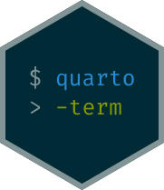

# quarto-term 


**quarto-term** is a [Quarto](https://quarto.org) extension that runs
commands in a real, persistent shell session. State carries across
cells, colors render faithfully, and you can drive fullscreen TUI apps,
all from your `.qmd` file.

quarto-term is great for:

- **Documentation and tutorials**: CLI tools, shell concepts,
  installation guides, git workflows, and API exploration with real
  output and persistent state
- **Technical books and courses**: faithful terminal rendering for any
  “type this, see that” sequence, including TUI walkthroughs, database
  demos, and data pipeline chains
- **DevOps and security**: runbooks, CTF writeups, and environment setup
  guides where colored tool output and multi-step sessions matter

```console
$ date
Fri Oct 30 16:47:01 CET 2026

$ EXTENSION_NAME="quarto-term"
```

```console
$ cowsay "Hello, I'm rendered using $EXTENSION_NAME"
 _______________________________________
< Hello, I'm rendered using quarto-term >
 ---------------------------------------
        \   ^__^
         \  (oo)\_______
            (__)\       )\/\
                ||----w |
                ||     ||

$ htop
```

```text

    0[||||||  41.2%]   4[||||    23.8%]   7[||        4.0%] 11[|         1.3%]
    1[||||||  38.9%]   5[||||    18.5%]   8[|         2.0%] 12[|         0.7%]
    2[|||||   31.1%]   6[|||     11.9%]   9[|         1.3%] 13[|         1.3%]
    3[|||||   25.7%]                     10[|         1.3%]
  Mem[|||||||||||||||||||||20.3G/24.0G] Tasks: 711, 4429 thr, 0 kthr; 2 runnin
  Swp[|||||||||||||||||||||7.32G/9.00G] Load average: 9.47 8.35 11.52
                                        Uptime: 10 days, 05:52:15

  [Main]
  PID USER       PRI  NI  VIRT   RES S  CPU%▽MEM%   TIME+  Command
 2369 jeroen      24   0 1628G  201M R   0.9  0.8 15:10.03 /Applications/Obsidia
99784 jeroen      17   0 1910G  287M S   0.4  1.2  0:00.04 /Applications/Vivaldi
13635 jeroen      17   0  467G 74080 S   0.3  0.3 16:38.10 /Applications/Elgato
86488 jeroen      26   0  471G  249M S   0.1  1.0  0:00.37 claude --dangerously-
66404 jeroen      24   0 1912G  263M S   0.1  1.1  0:11.07 /Applications/Vivaldi
 1972 jeroen      17   0  517G  106M S   0.1  0.4 12:17.82 /Applications/Vivaldi
97207 jeroen      17   0  467G  272M S   0.1  1.1  1:00.80 /Applications/WhatsAp
25742 jeroen      17   0  466G 14800 S   0.0  0.1  0:00.99 /System/Library/Frame
 1255 jeroen      17   0  470G 12960 S   0.0  0.1  6:47.44 osascript /Users/jero
34740 jeroen      17   0  472G  122M S   0.0  0.5 15:22.61 /Applications/zoom.us
 6063 jeroen      17   0  444G 51776 S   0.0  0.2  0:06.33 /Applications/kitty.a
99841 jeroen      17   0 1911G  103M S   0.0  0.4  0:00.00 /Applications/Vivaldi
F1Help  F2Setup F3SearchF4FilterF5Tree  F6SortByF7Nice -F8Nice +F9Kill  F10Quit
```

All of the above was produced from a single `.qmd` file using
quarto-term.

## Why quarto-term?

Quarto’s built-in `bash` engine executes each code cell in an isolated
subshell. That means:

- Variables, `cd`, and other state don’t persist between cells.
- You can’t show interactive TUI applications (htop, vim, nyancat).
- Output is plain text with no ANSI color support.
- There’s no way to send special keys (Ctrl-C, arrow keys).
- You can’t produce terminal recordings alongside your document.

quarto-term solves all of these by running a single persistent shell
session that all cells share. It captures output using a real terminal
emulator (including colors, cursor movement, and fullscreen apps), and
can optionally produce [asciicast](https://docs.asciinema.org/) or
[termshow](https://posit-dev.github.io/great-docs/user-guide/terminal-recordings.html)
recordings for playback.

## Features

- **Persistent sessions.** State carries across cells (variables,
  working directory, shell history).
- **ANSI color rendering.** Faithfully renders colored output as
  HTML/LaTeX.
- **Fullscreen capture.** Capture TUI apps like htop, vim, or nyancat.
- **Special keys.** Send Ctrl-C, arrow keys, Enter, Escape, and more.
- **Human typing simulation.** Configurable speed and error rate for
  realistic recordings.
- **Terminal recordings.** Produce `.cast` (asciicast v2) or `.termshow`
  files alongside your document.
- **Line options.** Control timing, key behavior, and prompt
  expectations per line.
- **Multi-line commands.** Automatic PS2 continuation prompt detection.
- **Styling.** Built-in colorschemes with light/dark mode support,
  fonts, and sizing.
- **Multiple output formats.** HTML, LaTeX/PDF, and Markdown.

## Quick install

``` bash
quarto add jeroenjanssens/quarto-term
```

On first render, the correct binary for your platform is automatically
downloaded from GitHub Releases and cached locally. Supported platforms:
macOS (ARM and Intel), Linux (x86_64 and ARM), and Windows.

See [Get
Started](https://quarto-term.jeroenjanssens.com/get-started.html) for a
complete walkthrough.
